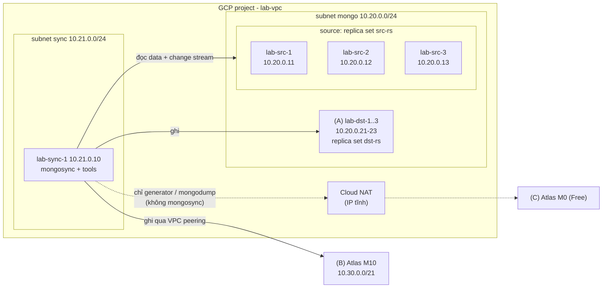

# Mongosync Home Lab

Lab tự dựng để **hiểu `mongosync` chạy thế nào** khi chuyển dữ liệu từ một MongoDB replica set
chạy trên VM sang một cụm MongoDB khác (online, ứng dụng vẫn đọc/ghi trong lúc sync), và để
**luyện cách debug / xử lý sự cố**.

Sau lab bạn sẽ:

- dựng được replica set MongoDB 8.0 có auth + keyFile trên VM (bằng Terraform/Terragrunt + script);
- chạy `mongosync`, điều khiển qua HTTP API (`start` → theo dõi → `commit` → `reverse`);
- sinh dữ liệu giả + traffic đọc/ghi liên tục để quan sát lag, write-blocking, cutover;
- kiểm tra destination có đủ dữ liệu không (count, index, `dbHash`);
- tái hiện và xử lý các lỗi hay gặp (thiếu RAM cho verifier, process chết, write block kẹt...).

> Lab chỉ dành cho học / thử nghiệm: password đơn giản, state Terraform lưu local, không có
> backup/monitoring như production.

## Kiến trúc



- **Source** luôn là 3 VM `lab-src-1..3` (replica set `src-rs`).
- **`lab-sync-1`** là máy duy nhất cần kết nối tới cả hai cụm: chạy `mongosync`, generator, connector, compare.
- **Destination**: chọn một trong ba hướng dưới đây.

## Chọn destination

| | (A) Cụm VM khác | (B) Atlas M10 | (C) Atlas M0 (Free) |
|---|---|---|---|
| Kiểu sync | self-managed → self-managed | self-managed → Atlas | **mongosync không hỗ trợ** |
| Kết nối từ `lab-sync-1` | IP nội bộ trong VPC | VPC peering (private SRV) | Internet qua IP NAT được whitelist |
| Terragrunt unit cần thêm | `gcp/dst-vms` | `atlas/m10-project`, `atlas/m10-cluster` | `atlas/m0-project`, `atlas/m0-cluster` |
| Chi phí | 3 VM e2-medium | M10 tính theo giờ (dedicated) | miễn phí |
| Học được | toàn bộ vòng đời mongosync, reverse, write-blocking | migrate lên Atlas, peering, quyền Atlas | Terraform Atlas, kết nối Atlas, migrate **offline** (`mongodump`/`mongorestore`), và vì sao shared tier không dùng được mongosync |

> **M0/Flex là shared tier: mongosync không chạy được với chúng** (cả vai trò source lẫn
> destination). Hướng (C) được giữ lại để luyện Terraform Atlas và so sánh với cách migrate offline.
> Muốn sync online lên Atlas thì phải dùng M10 trở lên.

Không có tài khoản cloud? Bắt đầu với **lab local bằng Docker** (miễn phí, 2 cụm 3 node trên
máy bạn): [docs/01-local-docker.md](docs/01-local-docker.md).

## Lộ trình

| Bước | Tài liệu | (A) VM | (B) M10 | (C) M0 | Local |
|---|---|:-:|:-:|:-:|:-:|
| 0 | [Mongosync hoạt động thế nào](docs/00-how-mongosync-works.md) | ✔ | ✔ | ✔ | ✔ |
| 1 | [Lab local bằng Docker](docs/01-local-docker.md) | | | | ✔ |
| 2 | [Dựng hạ tầng GCP (+ Atlas)](docs/02-gcp-infra.md) | ✔ | ✔ | ✔ | |
| 3 | [Cluster nguồn trên VM](docs/03-source-cluster.md) | ✔ | ✔ | ✔ | |
| 4 | [Cluster đích: VM / M10 / M0](docs/04-destination.md) | 4A | 4B | 4C | |
| 5 | [Cài lab-sync-1, sinh data và traffic](docs/05-data-and-traffic.md) | ✔ | ✔ | ✔ | ✔ |
| 6 | [Chạy mongosync: start → commit → reverse](docs/06-run-mongosync.md) | ✔ | ✔ | | ✔ |
| 7 | [Kiểm tra dữ liệu sau sync](docs/07-verify.md) | ✔ | ✔ | ✔ | ✔ |
| 8 | [Troubleshooting](docs/08-troubleshooting.md) | ✔ | ✔ | ✔ | ✔ |
| 9 | [Dọn tài nguyên](docs/09-cleanup.md) | ✔ | ✔ | ✔ | ✔ |

## Cấu trúc thư mục

```text
.
├── README.md                    # trang này
├── docs/                        # hướng dẫn từng bước (00 → 09)
├── infra/                       # Terraform modules + Terragrunt units
│   ├── .env.example             # template biến môi trường: GCP project, Atlas org/API key
│   ├── modules/
│   │   ├── gcp/{project,vpc,firewall,key-pair,instance}
│   │   └── atlas/{project,cluster}
│   └── live/
│       ├── root.hcl             # backend state local + input chung
│       ├── lab.yaml             # env / region / zone
│       ├── gcp/values.yaml      # cấu hình mọi unit GCP: <tên unit>: {config}
│       ├── gcp/{project,vpc,firewall,key-pair,src-vms,dst-vms,sync-vm}
│       ├── atlas/values.yaml    # cấu hình mọi unit Atlas
│       └── atlas/{m10-project,m10-cluster,m0-project,m0-cluster}
├── scripts/
│   ├── mongo/install-mongodb.sh # cài mongod 8.0 + keyFile + replSet lên 1 VM
│   ├── mongo/init-replset.js    # rs.initiate + user admin + user mongosync (dùng cho cả VM và Docker)
│   ├── download-mongosync.sh    # tải binary mongosync vào bin/mongosync
│   └── mongosync/
│       ├── config.example.yaml  # config mongosync cho VM
│       ├── mongosync.service    # systemd unit (tuỳ chọn)
│       └── ms.sh                # helper gọi HTTP API: status / start / commit / reverse ...
├── tools/                       # Node.js: generate, stats, clean, connector, compare
└── local/                       # docker-compose cho lab local
```

## Quy ước dùng trong lab

| Thành phần | Giá trị |
|---|---|
| Replica set nguồn | `src-rs`: `10.20.0.11-13:27017` (VM `lab-src-1..3`) |
| Replica set đích (A) | `dst-rs`: `10.20.0.21-23:27017` (VM `lab-dst-1..3`) |
| VM mongosync | `lab-sync-1` `10.21.0.10`, API `127.0.0.1:27182` |
| Atlas network (B) | `10.30.0.0/21`, cluster `lab-m10` |
| Atlas Free (C) | cluster `lab-m0`, whitelist IP Cloud NAT |
| User | `admin` (root), `mongosync` (quyền cho mongosync), `lab_app` (M0) |
| Region | GCP `us-central1-a`, Atlas `CENTRAL_US` |

## Bảo mật & chi phí

- Không commit `.env`, file state (`infra/live/.state/`), keyFile hay password. `.gitignore` đã
  chặn các file này; trước khi commit hãy chạy `git status` để chắc chắn.
- GCP project ID, Atlas org ID và API key chỉ nằm trong biến môi trường (xem
  [docs/02](docs/02-gcp-infra.md)); repo không chứa ID của ai.
- VM và M10 tính tiền theo giờ. Đặt budget alert, làm xong thì
  [dọn ngay](docs/09-cleanup.md).
