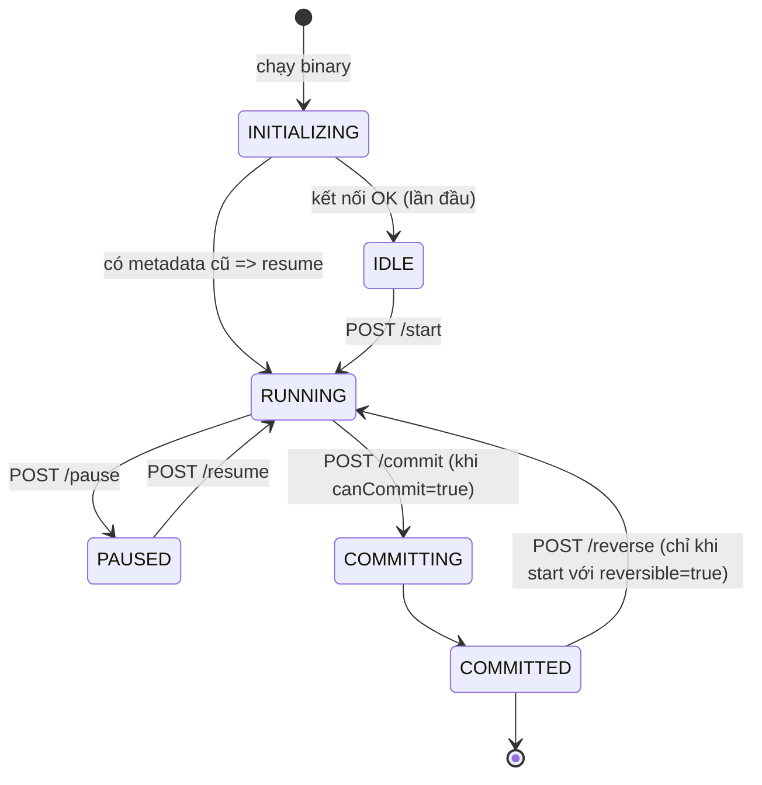

# 0. Mongosync hoạt động thế nào

Đọc trang này trước để các bước sau không còn là "gõ lệnh theo". Những hành vi ghi ✔ đã được
kiểm chứng bằng mongosync **1.22.0** + MongoDB **8.0** khi xây lab này.

## 0.1 Mongosync là gì

`mongosync` là một binary (không phải service của MongoDB server) đứng giữa hai cluster:

- **cluster0** và **cluster1**: hai connection string truyền vào khi khởi động. Khi gọi
  `/start` bạn chọn bên nào là `source`, bên nào là `destination`.
- Nó **đọc** source (copy toàn bộ collection, sau đó theo dõi change stream) và **ghi** vào destination.
- Nó **không** cần source và destination nhìn thấy nhau; chỉ máy chạy mongosync cần tới được cả hai.
- Nó được điều khiển qua **HTTP API** (mặc định `127.0.0.1:27182`). Không có giao diện web.
- Trạng thái của migration được lưu trong DB `__mdb_internal_mongosync` trên cluster **đích**.
  Nhờ vậy process chết thì chạy lại là **tự resume** ✔.

## 0.2 Vòng đời một migration



Trong `RUNNING` có hai giai đoạn, xem ở trường `progress.info`:

1. **collection copy**: copy dữ liệu đang có. `collectionCopy.estimatedCopiedBytes` tăng dần tới
   `estimatedTotalBytes`. Index được tạo trên destination.
2. **change event application**: đọc change stream của source và áp vào destination.
   `lagTimeSeconds` là độ trễ. Khi lag đủ nhỏ thì `canCommit` thành `true`.

`commit` nghĩa là: chặn ghi vào source, áp nốt các thay đổi còn lại, hoàn tất index, mở ghi
cho destination. Xong thì `state: COMMITTED` + `canWrite: true`, lúc này mới chuyển ứng dụng
sang destination (**cutover**).

> Sau khi restart, giai đoạn `INITIALIZING` có thể kéo dài **khoảng 2 phút** ✔ trước khi API
> trả về `IDLE`/`RUNNING`. Đừng gọi `/start` trong lúc này (lỗi `StartWhileInitializing`).

## 0.3 HTTP API dùng trong lab

| Endpoint | Ý nghĩa |
|---|---|
| `GET /api/v1/progress` | Trạng thái hiện tại (JSON nằm trong khoá `progress`) |
| `POST /api/v1/start` | Bắt đầu: `{"source":"cluster0","destination":"cluster1"}` + tuỳ chọn |
| `POST /api/v1/pause`, `/resume` | Tạm dừng / chạy tiếp |
| `POST /api/v1/commit` | Cutover |
| `POST /api/v1/reverse` | Sync ngược destination → source sau commit (cần `reversible: true` lúc start) |

Helper [`scripts/mongosync/ms.sh`](../scripts/mongosync/ms.sh) gói các lệnh trên:
`ms.sh status`, `ms.sh watch`, `ms.sh start`, `ms.sh commit`...

Ví dụ `ms.sh status` lúc đã copy xong, đang áp change event:

```json
{
  "state": "RUNNING",
  "canCommit": true,
  "canWrite": false,
  "phase": "change event application",
  "lagTimeSeconds": 1,
  "copied": "100%",
  "verification": null
}
```

Các tuỳ chọn hay dùng trong body của `/start`:

| Trường | Tác dụng |
|---|---|
| `"verification": {"enabled": false}` | Tắt embedded verifier (tiết kiệm RAM, xem 0.5) |
| `"reversible": true` | Cho phép `/reverse` sau commit |
| `"includeNamespaces": [{"database": "synctest_db_001"}]` | Chỉ sync một phần (thử sau khi đã quen) |

## 0.4 Write blocking: ai được ghi vào đâu, lúc nào ✔

Đã kiểm tra bằng một user ứng dụng bình thường (`readWriteAnyDatabase`):

| Thời điểm | Source | Destination |
|---|---|---|
| Đang `RUNNING` | ghi được | **bị chặn** |
| Sau `COMMITTED` | **bị chặn** | ghi được |
| Đang reverse | **bị chặn** (giờ nó là đích) | ghi được |
| Sau commit reverse | ghi được | **bị chặn** |

Lỗi ứng dụng nhận được: `User writes blocked, reason: Unspecified`.

Cần nhớ:

- User có role **`root`** (như `admin` trong lab) có quyền `bypassWriteBlockingMode`, nên **vẫn
  ghi được** khi đang bị chặn. Đừng test write blocking bằng user admin, kết quả sẽ sai.
- Mongosync tự chặn ghi source lúc commit, nhưng **vẫn nên dừng ứng dụng trước khi commit**:
  nếu không, ứng dụng sẽ nhận lỗi ghi trong lúc commit.
- Trong bản 1.22, `/start` **không còn** nhận khoá `enableUserWriteBlocking` của các bản cũ ✔
  (báo `Unrecognized key in request`). Nhiều bài viết cũ trên mạng vẫn dùng khoá này.

## 0.5 Embedded verifier và RAM ✔

Từ các bản 1.9+, mongosync có **embedded verifier** (bật mặc định) để tự kiểm tra dữ liệu sau
khi sync. Verifier cần nhiều RAM: với ~18.000 document, mongosync 1.22 từ chối start vì
"At least **11 GB** of RAM is estimated to be required" trên máy 7 GB (lỗi `VerifierMemoryLimit`).
Vì vậy:

- VM `lab-sync-1` dùng `e2-standard-4` (16 GB) để chạy được verifier;
- máy yếu hơn thì start với `"verification": {"enabled": false}` và tự kiểm tra bằng
  [docs/07-verify.md](07-verify.md).

## 0.6 Quyền cần cho user `mongosync`

- **Cluster self-managed** (VM, Docker): user `mongosync` do
  [`init-replset.js`](../scripts/mongo/init-replset.js) tạo, có `backup, clusterManager,
  clusterMonitor, readWriteAnyDatabase, restore, dbAdminAnyDatabase` cùng custom role
  `mongosyncOplog` (đọc `local.oplog.rs`, `bypassWriteBlockingMode`, `setUserWriteBlockMode`).
  Một user dùng được cho cả hai vai trò source/destination và cho reverse.
- **Atlas M10**: custom role `mongosyncDestination` = `atlasAdmin` + `BYPASS_USER_WRITE_BLOCK`,
  do module Terraform tạo.
- Tham khảo: <https://www.mongodb.com/docs/mongosync/current/reference/permissions/>

## 0.7 Những thứ mongosync KHÔNG làm

- Không sync DB `admin`, `config`, `local`, nên **user/role không được chuyển**. Phải tự tạo
  user ứng dụng trên destination.
- Không hỗ trợ Atlas shared tier (M0/Flex).
- Không tự đổi connection string của ứng dụng. Cutover là việc của bạn.
- Destination nên trống (không có DB trùng tên) trước khi start.
- Oplog của source phải đủ lớn để giữ được change event trong suốt giai đoạn copy. Script cài VM
  để oplog 2 GB.

Tài liệu chính thức: <https://www.mongodb.com/docs/mongosync/current/>

Tiếp theo: [Lab local bằng Docker](01-local-docker.md) hoặc
[Dựng hạ tầng GCP](02-gcp-infra.md).
